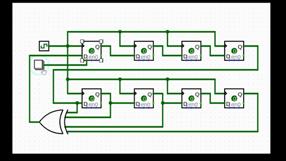

<h1 align="center">Takudzwa Masendeke</h1>

<b>FPGA & real-time DSP · Embedded & control systems · Electrical & Computer Engineering @ UCT</b>

  
  

 

I'm a third-year Electrical and Computer Engineering student at the University of Cape Town. I like working close to the hardware: digital logic in Verilog, firmware on microcontrollers, and the sensing and control loops that make physical systems behave.

## Projects

| Project | What it is | Stack |
| :--- | :--- | :--- |
| [**Micromouse**](https://github.com/takumasendeke/EEE3097S-Micro-Mouse) | Autonomous maze-solving robot: floodfill search, return home, then a shortest-path sprint. Sensor fusion with encoders, gyro and three ToF sensors feeding a corridor Kalman filter. 98.6/100 on the course simulator. | MicroPython · STM32L476 |
| [**Hygiene Hero**](https://github.com/takumasendeke/hygiene-hero) | Touchless handwashing coach that guides users through a 20-second wash with an LCD animation, 7-segment countdown and audio prompts, driven by a state machine. Custom PCB and 3D-printed enclosure. | C++ · Arduino · KiCad · Onshape |
| [**verilog-engineering-log**](https://github.com/takumasendeke/verilog-engineering-log) | Running log of digital design exercises, from combinational logic to flip-flops and state machines, each simulated and synthesised to a netlist. | Verilog · Icarus Verilog · GTKWave · Yosys |

## Languages & Tools

 

<b>Early experiment: 8-bit LFSR in Logisim</b>

 

One of the first circuits I built: an 8-bit linear feedback shift register made from edge-triggered flip-flops with XOR feedback taps, seeded with a single <code>1</code> to produce a pseudo-random sequence. A small simulation exercise, kept here because it's where the interest in digital logic started.

